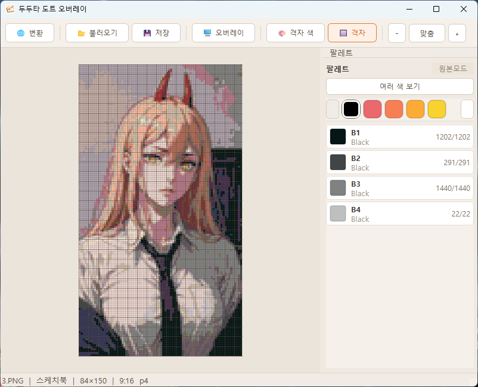
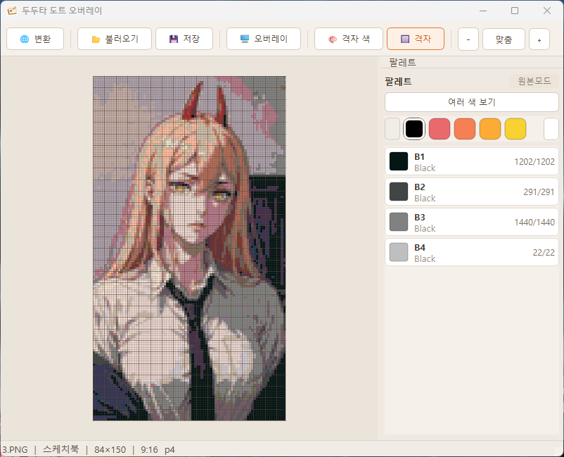
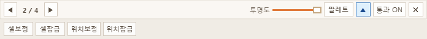
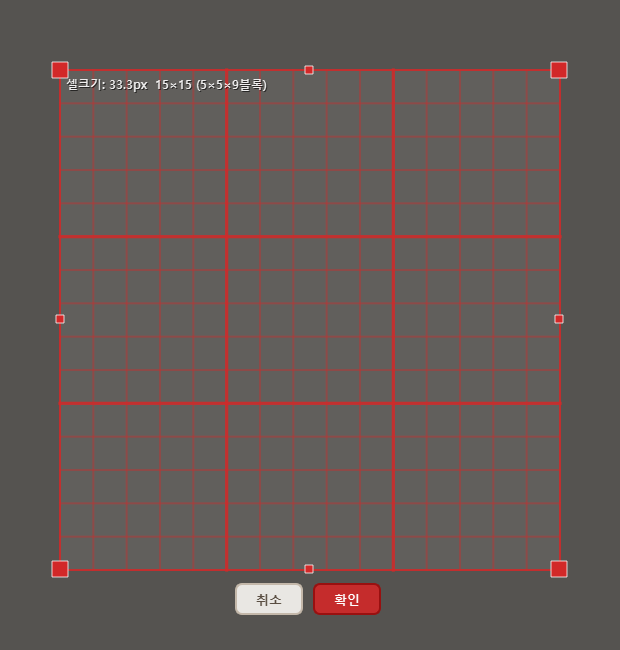
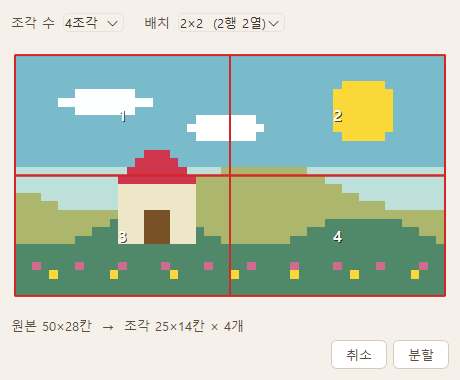
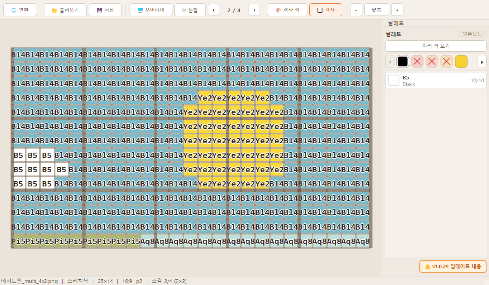

# 후원자 전용 윈도우 오버레이 프로그램

후원자만을 위한 윈도우 전용 오버레이 프로그램입니다.
개발자에게 후원 또는 커피한잔~ 을 보내주시면 게임화면 안에서 모든게 가능한 오버레이 프로그램을 보내드립니다.

> 현재 버전: **v1.0.29** (2026-10-09) — [업데이트 기록](#업데이트-기록)

---
## 후원

- [GitHub Sponsors로 후원하기](https://github.com/sponsors/chang-mini)
- [커피한잔의 여유(오픈카톡)](https://open.kakao.com/o/svvxQWki)

## 도안 만들기

오버레이에 띄울 도안 파일(`.dudot.json`)은 웹 변환 사이트에서 만듭니다.
프로그램 상단의 **🌐 변환** 버튼을 눌러도 바로 열립니다.

- [뜌타 스케치북 도트 변환 사이트](https://chang-mini.github.io/heartopia-sketchbook-dot/)

## 목차

1. [설치와 자동 업데이트](#1-설치와-자동-업데이트)
2. [기본 화면](#2-기본-화면)
3. [파일 불러오기와 저장](#3-파일-불러오기와-저장)
4. [오버레이 띄우기](#4-오버레이-띄우기)
5. [오버레이 창 조작](#5-오버레이-창-조작)
6. [팔레트 — 색상 선택](#6-팔레트--색상-선택)
7. [세부 색 체크](#7-세부-색-체크)
8. [셀 보정](#8-셀-보정)
9. [위치 보정](#9-위치-보정)
10. [통과 모드](#10-통과-모드)
11. [도안 조각 분할](#11-도안-조각-분할)
12. [자주 묻는 질문](#12-자주-묻는-질문)

---

## 1. 설치와 자동 업데이트

1. 받은 `HeartopiaOverlay_Setup_v1.0.X.exe`를 실행해 설치합니다.
2. 바탕화면 또는 시작 메뉴의 **Heartopia Dot Overlay**로 실행합니다.

- 프로그램을 켤 때 새 버전이 있으면 **업데이트 알림** 창이 뜹니다. **예**를 누르면 자동으로 내려받아 설치합니다.
- 업데이트 후 처음 실행하면 **업데이트 공지** 창이 자동으로 뜹니다. 닫은 뒤에도 팔레트 아래 **🔔 v1.0.X 업데이트 내용** 버튼으로 다시 볼 수 있습니다.
- **v1.0.22 이하** 버전은 자동 업데이트가 동작하지 않습니다. 최신 설치 파일로 한 번 직접 설치해 주세요.

---

## 2. 기본 화면

프로그램을 처음 실행하면 빈 캔버스와 상단 툴바, 우측 팔레트 패널이 표시됩니다.

| 버튼 | 기능 |
|------|------|
| 🌐 변환 | 웹 변환 사이트 열기 (이미지 → 도안 파일 만들기) |
| 📂 불러오기 | 도안 파일(`.dudot.json`) 불러오기 |
| 💾 저장 | 현재 작업 상태(완료 칸, 선택 색, 조각 진행도) 저장 |
| 🖥 오버레이 | 게임 화면 위 오버레이 창 열기/닫기 |
| ✂ 분할 | 도안을 여러 조각으로 나누기 ([11번](#11-도안-조각-분할) 참고) |
| ◀ n / N ▶ | 조각 이동 (분할했을 때만 표시) |
| 🎨 격자 색 | 격자선 색상 변경 |
| 🔲 격자 | 격자선 표시 ON/OFF |
| − 맞춤 + | 캔버스 줌 조절 (창이 좁으면 툴바 오른쪽 끝 확장 버튼 `»` 안에 있습니다) |

**캔버스 마우스 조작** (메인 화면과 오버레이 모두 동일)

| 조작 | 기능 |
|------|------|
| 휠 | 확대 / 축소 |
| 왼쪽 드래그 | 도안 이동 |
| 왼쪽 클릭 | 칸 하나 완료 / 완료 해제 |
| 휠 버튼(가운데) 누른 채 드래그 | 지나간 칸을 한 번에 완료 (완료된 칸에서 시작하면 한 번에 해제) |

---

## 3. 파일 불러오기와 저장

**불러오기** 버튼을 눌러 도안 파일(`.dudot.json`)을 열면 캔버스에 도안이 표시되고, 우측 팔레트에 사용된 색상 목록이 나타납니다.

- 각 색상 칩에는 **색 코드**, **그룹명**, **남은 칸 수 / 전체 칸 수**가 표시됩니다.
- 색상 칩을 클릭하면 해당 색이 활성화되어 오버레이에서 해당 위치만 강조됩니다.
- 웹의 **멀티 스케치북 묶음 파일**(`*_bundle.dudot.json`)도 불러올 수 있습니다. 모든 조각이 함께 열리고 ◀ ▶로 넘겨 볼 수 있습니다.

**저장과 이어하기**

- **저장** 버튼을 누르면 완료한 칸, 선택한 색, 조각별 진행도까지 파일에 저장됩니다.
- 프로그램을 닫으면 마지막 작업 상태가 자동으로 기억되어, 다음에 켤 때 그대로 이어집니다. (원본 파일을 옮기거나 지우면 이어지지 않으니, 중요한 작업은 **저장**해 두세요.)

---

## 4. 오버레이 띄우기

**오버레이** 버튼을 누르면 게임 화면 위에 반투명 도안 창이 올라옵니다.

- 오버레이 창은 항상 최상위에 유지됩니다.
- 게임 캔버스 위치에 맞게 상단 컨트롤 바를 드래그해 이동하거나, 창 가장자리를 드래그해 크기를 조절하세요.
- 정확히 맞추려면 [셀 보정](#8-셀-보정) 또는 [위치 보정](#9-위치-보정)을 사용하세요.

---

## 5. 오버레이 창 조작

오버레이 창 상단 컨트롤 바에서 다양한 기능을 제어합니다.

| 컨트롤 | 기능 |
|--------|------|
| ◀ n / N ▶ | 조각 이동 (분할했을 때만 표시, `PgUp` / `PgDn` 키도 가능) |
| 투명도 슬라이더 | 오버레이 전체 투명도 조절 |
| 팔레트 / 작업뷰 | 팔레트 패널로 전환 (팔레트 화면에서는 **작업뷰**를 눌러 도안으로 복귀) |
| ▼ / ▲ | 보정 버튼 줄 열기/닫기 |
| 통과 ON / 통과 OFF | 클릭 통과 모드 켜기/끄기 ([10번](#10-통과-모드) 참고) |
| ✕ | 오버레이 창 닫기 |

**▼** 버튼을 누르면 아래 보정 버튼 줄이 나타납니다.

| 버튼 | 기능 |
|------|------|
| 셀보정 | 게임 격자 한 칸 크기에 오버레이 격자를 맞춤 |
| 셀잠금 | 칸 크기 고정 (잠그면 휠 확대/축소가 막힘) |
| 위치보정 | 도안 전체를 게임 캔버스 위치/크기에 맞춤 |
| 위치잠금 | 도안 위치 고정 (잠그면 드래그 이동이 막힘) |

---

## 6. 팔레트 — 색상 선택

**팔레트** 버튼을 누르면 오버레이가 팔레트 패널로 전환됩니다.

- **그룹**: 상단의 색상 원형 버튼으로 색상 그룹을 전환합니다. 모든 그룹 색상이 표시되며 사용하지 않는 색상 그룹은 X로 표시됩니다. 창 너비에 따라 한 번에 보이는 개수가 바뀌고, ◀ ▶로 넘깁니다.
- **원본모드 / 멀티모드**: 오른쪽 위에 현재 모드가 표시됩니다.
  - **여러 색 보기**를 누르면 멀티모드로 바뀌어 여러 색을 동시에 오버레이에 표시합니다.
  - 멀티모드에서 **전체 보기**를 누르면 원본모드로 돌아갑니다.
- **색상 칩**: 클릭하면 해당 색이 현재 작업 색으로 선택됩니다.
  - 숫자는 멀티모드에서의 선택 순서입니다.
  - `완료` 표시된 색은 모든 칸이 채워진 상태입니다.
- **하단 상태 바**: 현재 선택된 색의 완료 칸 수 / 전체 칸 수가 실시간으로 표시됩니다. 다 채우면 `✓ 완료!`로 바뀝니다.

---

## 7. 세부 색 체크

| 색상 표시 | 완료 체크 후 |
|-----------|-------------|
|  |  |

팔레트에서 색을 선택하면 오버레이에 해당 색의 위치만 강조되어 표시됩니다.

- 게임에서 해당 칸을 채운 뒤, 팔레트의 **(색 코드) 완료** 버튼을 누르면 그 색의 모든 칸이 한 번에 체크됩니다. 다시 누르면(**완료 해제**) 되돌립니다.
- 칸 단위로 체크하려면 칸을 **왼쪽 클릭**하거나 **휠 버튼을 누른 채 드래그**하세요.
- 완료된 칸은 오버레이에서 흐리게 바뀌어 나머지 작업 위치를 더 명확하게 확인할 수 있습니다.

---

## 8. 셀 보정

오버레이 격자와 게임 캔버스 격자가 맞지 않을 때 **셀보정**을 사용합니다.

1. 컨트롤 바의 **▼** → **셀보정**을 누르면 화면 가운데에 빨간 **15×15 격자 박스**가 나타납니다. (5칸마다 굵은 선)
2. 박스를 드래그해 옮기고, 모서리를 드래그해 크기를 조절합니다. 박스는 항상 정사각형입니다.
3. 박스의 **+ 모양 굵은선**을 게임 격자의 **굵은선**에 맞춥니다.
4. **확인**을 누르면 칸 크기와 위치가 계산되어 오버레이에 적용됩니다. (`ESC` 또는 **취소**로 중단)
5. 보정이 끝나면 **셀잠금**이 자동으로 켜집니다.

> 박스 왼쪽 위에 현재 칸 크기(px)가 표시됩니다. 게임 화면을 확대한 상태에서 맞추면 더 정확합니다.

---

## 9. 위치 보정

도안 전체를 게임 캔버스 영역에 한 번에 맞추고 싶을 때 **위치보정**을 사용합니다.

1. 컨트롤 바의 **▼** → **위치보정**을 누르면 도안 비율에 맞는 박스가 나타납니다.
2. 박스를 게임 캔버스 그림 영역에 맞게 옮기고 크기를 조절합니다.
3. **확인**을 누르면 오버레이 창이 박스 위치·크기로 바뀌고 **위치잠금**이 자동으로 켜집니다. (`ESC` 또는 **취소**로 중단)

---

## 10. 통과 모드

| 통과 ON — 오버레이 뒤로 게임 조작 | 통과 on 팔레트 색칠 |
|----------------------------------|----------------|
|  |  |

**통과 ON** 버튼을 누르면 오버레이가 마우스 클릭을 투과해 게임을 직접 조작할 수 있게 됩니다.
- 통과 모드에서도 오버레이 위 **컨트롤 바**를 눌러 이동할 수 있습니다.
- 통과 모드에서도 오버레이 위에서 **휠**로 도안을 확대/축소할 수 있습니다. (셀잠금 중에는 막힘)
- **통과 OFF** 버튼을 눌러 일반 모드로 돌아옵니다.

---

## 11. 도안 조각 분할

큰 도안을 여러 장의 스케치북에 나눠 그릴 때 사용합니다. 조각마다 팔레트와 진행도가 따로 관리됩니다.

1. 도안을 불러온 뒤 툴바의 **✂ 분할**을 누릅니다.
2. **조각 수**(2 / 4 / 6 / 8 / 10)와 **배치**(예: 2×3 = 2행 3열)를 고릅니다. 미리보기에 분할선과 조각 번호, 조각 하나의 칸 수가 표시됩니다.
3. **분할**을 누르면 도안이 조각으로 나뉩니다.

- 툴바와 오버레이 컨트롤 바의 **◀ n / N ▶** 또는 `PgUp` / `PgDn` 키로 조각을 넘깁니다.
- 아래 상태 줄에 `조각 2/4 (2×2)`처럼 현재 조각이 표시됩니다.
- 조각마다 완료 칸·선택 색이 따로 기억되고, **저장**하면 모든 조각의 진행도가 하나의 파일에 저장됩니다.
- 오버레이에서 셀잠금/위치잠금을 켜 둔 상태라면 조각을 넘겨도 칸 크기와 위치가 유지됩니다.
- 다시 **✂ 분할**을 눌러 **분할 해제**를 하면 원본 하나로 돌아가고, 조각별 진행도는 원본에 합쳐집니다.
- 웹에서 만든 **멀티 스케치북 파일**은 이미 조각으로 나뉘어 있어 다시 분할할 수 없습니다. ◀ ▶로 넘겨 보세요. (웹의 9분할·12분할 파일도 그대로 열립니다.)

---

## 12. 자주 묻는 질문

**Q. 오버레이 격자가 게임 격자와 조금씩 어긋나요.**
A. [셀 보정](#8-셀-보정)으로 칸 크기를 다시 맞춰 주세요. 맞춘 뒤에는 **셀잠금**을 켜 두면 휠을 굴려도 크기가 바뀌지 않습니다.

**Q. 휠로 확대/축소가 안 돼요.**
A. **셀잠금**이 켜져 있으면 확대/축소가 막힙니다. ▼ → **셀잠금**을 눌러 해제하세요.

**Q. 도안이 드래그로 안 움직여요.**
A. **위치잠금**이 켜져 있으면 이동이 막힙니다. ▼ → **위치잠금**을 눌러 해제하세요.

**Q. 업데이트 알림이 안 떠요.**
A. v1.0.22 이하 버전은 자동 업데이트가 되지 않습니다. 최신 설치 파일로 다시 설치해 주세요.

버그가 있으면 오픈카톡으로 제보 부탁드립니다.

---

## 업데이트 기록

| 버전 | 내용 |
|------|------|
| v1.0.29 | 도안 조각 분할 기능 (✂ 분할, ◀ ▶ / PgUp·PgDn 이동), 조각별 팔레트·진행도 저장, 분할 해제 시 진행도 합치기, 웹 멀티 스케치북 묶음 파일의 모든 조각 보기 |
| v1.0.28 | 업데이트 후 공지 창 + 공지 버튼, 셀보정 15×15 격자 방식으로 개선, 웹 멀티 스케치북 파일 불러오기, 자동 업데이트 안정화 |
| v1.0.18 | 셀보정 박스 크기 동기화 |
| v1.0.14 ~ 1.0.17 | 자동 업데이트 후 재실행 여부 선택, 업데이트 중 검은 창 제거 |
| v1.0.13 | 격자 얇은 선 색 적용, 격자 색 기억 |
| v1.0.11 | 통과 모드에서 휠 확대/축소, 줌 단계 개선 |
